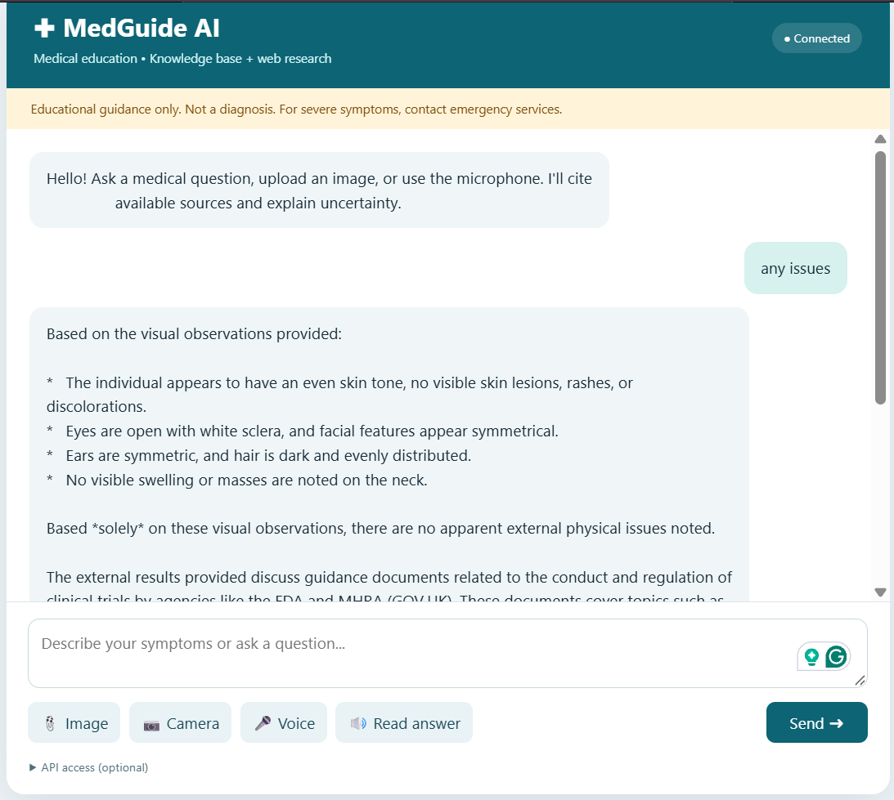

# MedGuide AI — LangGraph + Pinecone + FastAPI

An educational medical assistant with retrieval from the bundled historical Gale Encyclopedia of Medicine (2002, Volume 1 A–B), optional Tavily fallback, image observations, speech input/output, and a vanilla JS web UI.

## Demo


## Architecture


## Requirements
Python 3.11 or 3.12; an API key for the selected provider (OpenAI or Gemini) and a Pinecone API key; internet connection. Tavily and Langfuse credentials are optional. This is a reference implementation, **not** a clinically validated diagnostic system or HIPAA-compliant deployment.

## Start
```bash
python -m venv venv

source venv/bin/activate

# On Windows use:
# venv\Scripts\activate

pip install -r requirements.txt

cp env.example.txt .env

# Edit .env with real API keys

python ingest.py --pdf data/Medical_book.pdf

uvicorn app.main:app --reload --host 127.0.0.1 --port 8000
```

macOS/Linux: `python3 -m venv .venv && source .venv/bin/activate`, then install and run the same commands.

Open **http://127.0.0.1:8000**. API documentation: **http://127.0.0.1:8000/docs**. `/api/health` checks configuration and reports the selected embedding model, dimensions, and index. Run `ingest.py` once per provider before chatting; it makes paid embedding calls and creates a Pinecone serverless index. Both default embedding configurations use 1536 dimensions. If changing the embedding model or dimensions, use a fresh index and re-ingest the PDFs.

## Structure
- `app/config.py` — environment and Conda SSL certificate workaround
- `app/knowledge.py` — Pinecone vector retrieval
- `app/agent.py` — LangGraph retrieve → route → Tavily (when needed) → answer
- `app/main.py` — FastAPI, provider-selected images, transcription, and speech synthesis
- `app/tracing.py` - Optional Langfuse callbacks and shutdown
- `ingest.py` — chunk and embed every readable PDF page
- `templates/index.html` — UI
- `static/style.css`, `static/app.js` — styles and browser controls
- `data/Medical_book.pdf` — user-supplied reference PDF

## Gemini API
`LLM_PROVIDER` selects the provider for **all AI calls**: chat, image observations, document and query embeddings, audio transcription, and speech synthesis. OpenAI remains the default. To use only Gemini, configure `.env`:

```dotenv
LLM_PROVIDER=gemini
GEMINI_API_KEY=your_google_ai_studio_key
GEMINI_CHAT_MODEL=gemini-2.5-flash
GEMINI_VISION_MODEL=gemini-2.5-flash
GEMINI_EMBED_MODEL=gemini-embedding-001
GEMINI_EMBED_DIMENSIONS=1536
GEMINI_TRANSCRIBE_MODEL=gemini-2.5-flash
GEMINI_TTS_MODEL=gemini-2.5-pro-preview-tts
GEMINI_TTS_VOICE=Kore
PINECONE_INDEX=medical-agent-demo
```

Create a key at https://aistudio.google.com/apikey. Only `GEMINI_API_KEY` and `PINECONE_API_KEY` are required in Gemini mode; `OPENAI_API_KEY` may be empty. Model names can be changed to models available to your account. The app uses Google's OpenAI-compatible endpoint for chat/images and Google's native SDK for embeddings/audio. Gemini speech synthesis returns browser-playable WAV; OpenAI speech synthesis returns MP3. Gemini TTS uses a dedicated speech model, not the chat model, and may have different availability, quota, and pricing. Failures never fall back to the other provider.

After selecting Gemini, ingest your PDF again and restart the server:

```powershell
.\venv\Scripts\python.exe ingest.py --pdf data/Medical_book.pdf
.\venv\Scripts\python.exe -m uvicorn app.main:app --reload --host 127.0.0.1 --port 8000
```

With the default `PINECONE_INDEX=medical-agent-demo`, OpenAI uses `medical-agent-demo` and Gemini uses `medical-agent-demo-gemini`. The OpenAI index and its vectors are not deleted or overwritten. Gemini ingestion and retrieval share a namespace containing the embedding model and dimensions. Gemini document embeddings use the document retrieval task; searches use the query retrieval task. `gemini-embedding-2` is also supported with its text prefixes and separate content objects for each input. All Gemini vectors are normalized before storage or querying. Changing models requires re-ingestion, even when dimensions match. Existing indexes with incompatible dimensions are rejected; change `PINECONE_INDEX` to a fresh base name instead of deleting existing data.

To switch back, set `LLM_PROVIDER=openai`, provide `OPENAI_API_KEY`, and restart. OpenAI resumes using its original index, `text-embedding-3-small`, Whisper, and OpenAI TTS. `OPENAI_EMBED_DIMENSIONS` defaults to 1536 and must match that index. Pinecone, optional Tavily search, and optional Langfuse tracing remain independent services, not LLM providers.

## Langfuse Tracing
Install the updated requirements, create a Langfuse project, and configure `.env`:

```dotenv
LANGFUSE_ENABLED=true
LANGFUSE_PUBLIC_KEY=pk-lf-your-project-key
LANGFUSE_SECRET_KEY=sk-lf-your-project-key
LANGFUSE_BASE_URL=https://cloud.langfuse.com
```

Use your project's regional or self-hosted base URL (for example, `https://us.cloud.langfuse.com` for the US). Restart the server. Each chat graph run records retrieval, routing, optional web search, and the answer generation, including LangChain model usage and timing. Conversations are grouped using `X-Conversation-ID` as the Langfuse session ID. The client batches exports and shuts down on application exit. Initialization failures or missing tracing keys do not prevent chat from working.

Tracing is **disabled by default**. Enabling it exports graph inputs and outputs, including questions, history, retrieved text, and image descriptions, to Langfuse. Direct image-analysis and audio API calls are not separately instrumented. Do not enable tracing for identifiable patient data without consent, appropriate agreements, and a reviewed privacy and retention policy. Keep all credentials server-side.

## Integration Tests
Run `python -m unittest test_integrations -v` in the project environment. Tests mock external services and use an in-memory SQLite checkpointer; they do not make paid API calls or export traces.

## Troubleshooting
- **Connecting / checking**: run `uvicorn` and open `/api/health` first. Check browser console and backend terminal.
- **401**: if `API_TOKEN` is configured, enter it in the UI's API access section. Do not expose this token in a public browser deployment.
- **502**: inspect backend terminal; verify the selected provider's key, model access and quota, Pinecone service availability, embedding dimensions, and SSL certificate.
- **Camera/microphone**: browser permissions and localhost or HTTPS required.
- **No KB results**: run `python ingest.py` and wait for successful completion; ensure same index and API keys.
- **Tavily**: optional but needed for external fallback. Without its key, external search is disabled.

## Security and production limitations
This project is a functional scaffold, not a production medical device. Before deploying to real patients: replace shared API token with server-side identity/authentication; add database-backed encrypted conversations and retention/deletion controls; enforce request throttling and upload content verification; implement observability, tests, clinically reviewed emergency triage and evaluation; verify licensing to host/index the Gale PDF; obtain privacy/security/legal review; ensure current authoritative clinical references; and secure the deployment behind HTTPS. Do not send identifiable patient data to third-party APIs without appropriate consent and agreements.

The historical book may contain obsolete clinical advice; model instructions do not guarantee safety. Images can be described but cannot confirm or rule out disease. This software does not make diagnosis.
